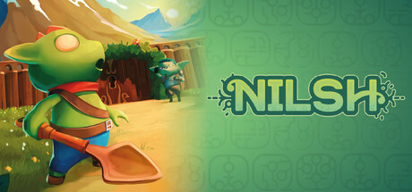
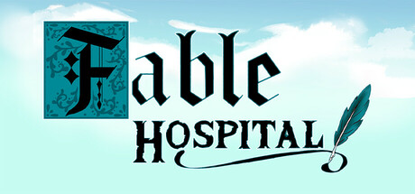

# Iván Contreras Guevara — Game Developer

**Unity Developer · Tech Lead**

Game developer with a Master's in Video Game Design & Development and a background in backend engineering. Currently Unity Tech Lead on **NILSH**; previously gameplay programmer on **Fable Hospital**.

**[View the portfolio →](https://belsel.github.io/gamedev-portfolio/)** (English and Spanish)

[CV (EN)](cv/CV-Ivan-Contreras-Guevara-EN.pdf) · [CV (ES)](cv/CV-Ivan-Contreras-Guevara-ES.pdf) · [LinkedIn](https://www.linkedin.com/in/ivan-contreras-guevara/) · [i.contrerasGuevara@outlook.es](mailto:i.contrerasGuevara@outlook.es)

## Featured games

|  |  |
| :--- | :--- |
| **NILSH** — Unity Tech Lead, 2026 | **Fable Hospital** — Gameplay Programmer, 2025 |
| Exploration-focused action-adventure in a fantasy world where nature is fading away. In development at Equipo Hoja. | Medieval hospital management sim with fantasy and humor. Released in 2025, AMGames TC. |
| [Steam](https://store.steampowered.com/app/4916130/NILSH/) · [Official site](https://nilsh.games) | [Steam](https://store.steampowered.com/app/2726060/Fable_Hospital/) · [Press kit](https://www.devuego.es/en/presskit/fable-hospital) |

## More game work

- **[Chess Revolution](https://devuego.es/bd/en/presskit/chess-revolution)** (The Traveler Games): design and development on a strategy chess game for Windows.
- **Legends of Learning** (Digital Monster Collective): designed and developed several educational serious games for the platform.
- **[Virtual Chess](https://github.com/Belsel/mochicake-tech-interview)** (Unity, C#): 3D chess with a minimax + alpha-beta AI, polished game feel and a modular, unit-tested architecture.

## Skills

| | |
| :--- | :--- |
| **Engines & languages** | Unity, Unreal Engine 5, Godot, C# |
| **Game tech** | Netcode for GameObjects, Spine, FMOD |
| **Workflow** | Git, Jira, SCRUM (Agile), unit testing |
| **Backend & tools** | Java, Spring Boot, React, SQL |
| **Languages** | Spanish, English |

## Open to work

I'm open to game development roles in Unity, gameplay and technical leadership. The best way to reach me is by [email](mailto:i.contrerasGuevara@outlook.es) or on [LinkedIn](https://www.linkedin.com/in/ivan-contreras-guevara/).

---

This repo holds the source of the portfolio site, built with plain HTML, CSS and JavaScript and hosted on GitHub Pages. Game art and logos © their respective owners.
